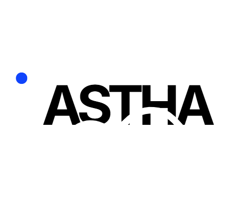
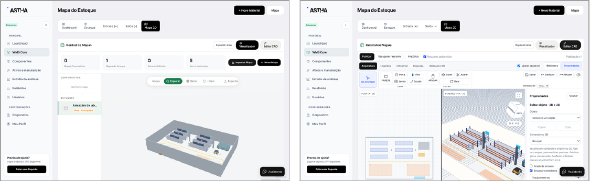
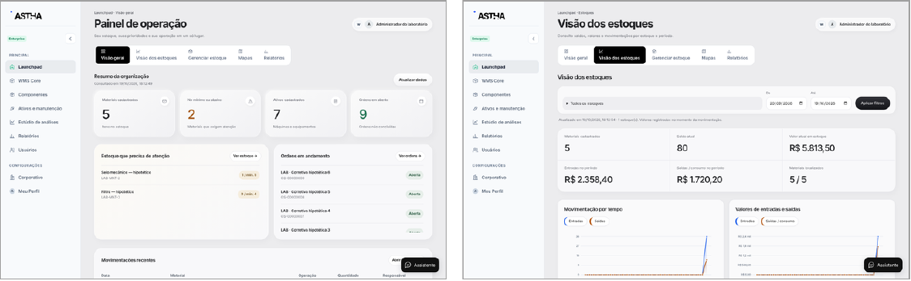
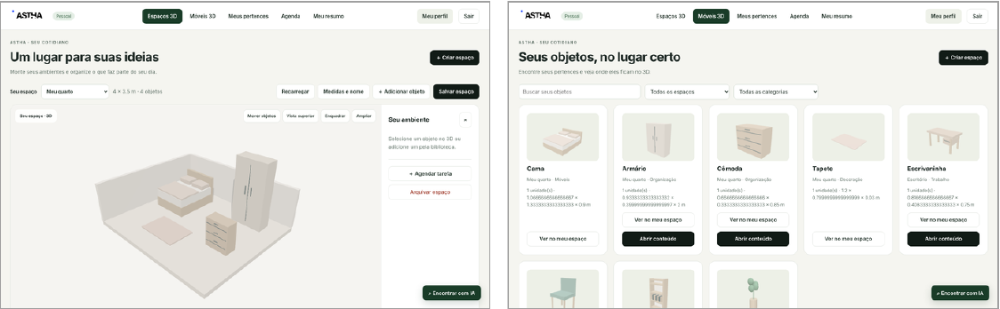
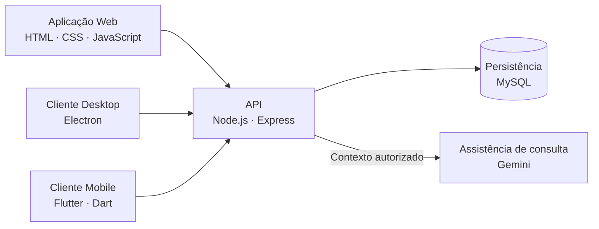

<p align="center">
  
</p>

<h1 align="center">ASTHA RAVEN</h1>

<p align="center">
  <strong>Gestão de materiais, acompanhamento de manutenção e organização espacial 2D/3D.</strong><br>
  Projeto de conclusão do curso Técnico em Desenvolvimento de Sistemas · COTIL / Unicamp · 2026
</p>

<p align="center">
  <a href="#a-ideia">A ideia</a> ·
  <a href="#funcionalidades">Funcionalidades</a> ·
  <a href="#interfaces">Interfaces</a> ·
  <a href="#arquitetura">Arquitetura</a> ·
  <a href="#executar-o-cliente-flutter">Executar o Flutter</a> ·
  <a href="#autores-e-orientação">Autores</a>
</p>



> Protótipo acadêmico com modalidades corporativa e pessoal. As capturas deste README foram extraídas do TCC e utilizam dados fictícios de laboratório.

## A ideia

O ASTHA RAVEN relaciona **o que está cadastrado, onde está localizado e o que aconteceu com esse registro**. A proposta é reunir informações que costumam ficar distribuídas entre planilhas, catálogos e históricos de manutenção, associando os dados à representação dos ambientes.

Na **modalidade corporativa**, o foco está em materiais, estoques, ativos, componentes e atividades de manutenção. Na **modalidade pessoal**, a mesma organização por localização é aplicada a cômodos, móveis, gavetas, pertences e tarefas.

Um material pode ser relacionado a uma posição em um armazém; um pertence pode ser associado à gaveta de um móvel. A consulta apresenta a localização cadastrada e o histórico disponível.

## Funcionalidades

| Área | Recursos apresentados no projeto |
| --- | --- |
| **Materiais e estoque (WMS)** | Cadastro de materiais, códigos, unidades, imagens, valores, parâmetros de mínimo/máximo, localização e consulta de saldos. |
| **Movimentações** | Registro de entradas e saídas, validação de quantidade e saldo e histórico operacional. |
| **Mapas 2D/3D** | Visualização dos espaços, edição de layouts, biblioteca de modelos, parâmetros geométricos, rascunhos e revisões. |
| **Ativos e manutenção (EAM)** | Cadastro de equipamentos, criticidade, localização, ordens de serviço, planos preventivos e histórico de intervenções. |
| **Componentes (BOM)** | Associação de materiais a ativos e consulta das quantidades previstas e dos saldos disponíveis. |
| **Estúdio de Análises** | Acompanhamento periódico de registros, filtros e estudos salvos com conjuntos de dados versionados e gráficos. |
| **Organização pessoal** | Ambientes, móveis, repartições, pertences, histórico de localização e agenda de tarefas. |
| **Conta e organização** | Configuração inicial, perfil, membros, cargos, grupos de acesso, sessões e recursos de segurança da conta. |
| **Assistência de consulta** | Integração com Gemini para apoiar dúvidas de uso e consultas ao contexto autorizado do sistema. |

### Análises e indicadores

O Estúdio contempla séries temporais, histogramas com referência Normal, gráficos Q-Q, distribuição acumulada empírica, Pareto, Kaplan-Meier e Weibull, conforme os dados e as condições do método. Os indicadores de manutenção incluem **MTTR, MTBF e disponibilidade**, quando existem registros adequados de operação, falha e reparo.

O acompanhamento operacional descrito no TCC consulta os registros **a cada cinco segundos enquanto habilitado**. Os gráficos representam os dados registrados no sistema; a aquisição física de sensores depende de integração específica. Bases insuficientes são sinalizadas para evitar resultados sem sustentação.

## Interfaces

### Painel operacional e visão dos estoques



O Launchpad reúne atalhos e avisos. A visão dos estoques apresenta quantidades, valores registrados e movimentações para apoiar a consulta da operação.

### Ambientes e organização pessoal



Na modalidade pessoal, os ambientes podem conter móveis com locais internos, como gavetas e repartições. Os pertences são associados a esses locais. A consulta assistida utiliza a **última localização informada pelo usuário** e seu histórico, sem rastreamento físico automático.

*Imagens: elaboração dos autores, reproduzidas das figuras 9, 14 e 27 da documentação do TCC. São registros da versão documentada.*

## Arquitetura



A API concentra as operações de domínio, o acesso à persistência e as verificações de autenticação, autorização e pertencimento dos dados. A arquitetura considera o escopo da organização e a propriedade dos recursos pessoais. Os clientes utilizam a API; credenciais do banco de dados pertencem ao ambiente do servidor.

| Camada | Tecnologias |
| --- | --- |
| Interface Web | HTML5, CSS3 e JavaScript |
| API | Node.js e Express |
| Persistência | MySQL e SQL |
| Representação espacial | Three.js / WebGL e Canvas 2D |
| Visualizações analíticas | SVG |
| Desktop | Electron |
| Mobile | Flutter e Dart |
| Controle de acesso | Hash de senhas, sessões JWT e permissões |
| Assistência | Integração controlada com Gemini |

## Navegar pelo repositório

Este repositório reúne os componentes e os materiais acadêmicos do projeto. Os diretórios históricos preservam os nomes e as versões em que foram importados.

| Diretório | Conteúdo |
| --- | --- |
| [MOBILE/ASTHA_MOBILE](MOBILE/ASTHA_MOBILE/) | Cliente Flutter: fontes, recursos, testes e configuração Android/Web. |
| [DESKTOP APP](<DESKTOP APP/>) | Fontes e materiais históricos do Desktop e backend, organizados por versão. |
| [SITE ASTHA](<SITE ASTHA/>) | Snapshot dos arquivos do site importado. |
| [DATABASE (BANCO DE DADOS)](<DATABASE (BANCO DE DADOS)/>) | Documentação do esquema de dados. |
| [DOCUMENTAÇÃO](<DOCUMENTAÇÃO/>) | Planejamento, estudos, identidade visual e mockups. |
| [IMPORT_SECURITY_REVIEW.md](IMPORT_SECURITY_REVIEW.md) | Registro da revisão da importação, configuração e limites do snapshot inicial. |

A descrição funcional deste README segue o TCC. Ao executar um componente, consulte os arquivos e as instruções da versão correspondente: o conteúdo histórico de Web/Desktop e o cliente Flutter têm ciclos próprios de atualização.

## Executar o cliente Flutter

**Pré-requisitos:** Flutter com Dart compatível com o `pubspec.yaml`, Chrome/Edge para Web ou ambiente Android configurado.

```sh
git clone https://github.com/Cir0Arruda/Projeto-integrador---GERAL-Cotil.git
cd Projeto-integrador---GERAL-Cotil/MOBILE/ASTHA_MOBILE
flutter pub get
flutter run -d chrome --web-hostname=localhost --web-port=7357
```

A porta `7357` corresponde à origem de desenvolvimento configurada no cliente. A API deve estar acessível e permitir a origem utilizada. Para Android, selecione o aparelho/emulador listado por `flutter devices` e execute `flutter run -d ID_DO_DISPOSITIVO`.

Para informar outra API no build:

```sh
flutter run -d chrome --web-hostname=localhost --web-port=7357 --dart-define=ASTHA_API_URL=https://SEU_DOMINIO
```

Verificações do cliente:

```sh
flutter analyze
flutter test
```

Consulte o [README do Mobile](MOBILE/ASTHA_MOBILE/README.md) para os detalhes de conexão, modelos 3D, QR e diferenças entre ambientes. Os componentes Web/Desktop devem ser executados conforme a configuração da versão em suas pastas.

## Documentação e alcance da avaliação

**Título do TCC:** *ASTHA RAVEN: protótipo integrado para gestão de materiais, acompanhamento de manutenção e organização espacial 2D/3D.*

A documentação apresenta requisitos, modelagem de dados, casos de uso, arquitetura, interfaces e resultados. Na revisão técnica de **20 de outubro de 2026**, o TCC registra **208 arquivos JavaScript analisados e 394 testes aprovados em Windows**, relativos à versão e aos cenários examinados. Esses números são evidência histórica do trabalho, e não uma nova execução feita na atualização deste README.

A aplicação Web/API é a referência de implementação e verificação descrita no documento. Desktop e Mobile têm avaliação própria por ambiente. A continuidade do projeto inclui consolidação dos contratos entre clientes, operação offline durável e sincronização, avaliações em dispositivos e ensaios de desempenho, acessibilidade, segurança e uso em campo.

## Autores e orientação

| Participação | Nome |
| --- | --- |
| Autor | **Ciro Eduardo Arruda Costa** |
| Autor | **Gustavo Breder Leal** |
| Orientadora | **Prof.ª Priscila Keli Lima Pinto Frizzarin** |
| Instituição | **Colégio Técnico de Limeira (COTIL) — Universidade Estadual de Campinas (Unicamp)** |
| Curso / ano | **Técnico em Desenvolvimento de Sistemas · 2026** |

---

Desenvolvido como Trabalho de Conclusão de Curso em Limeira, São Paulo.
